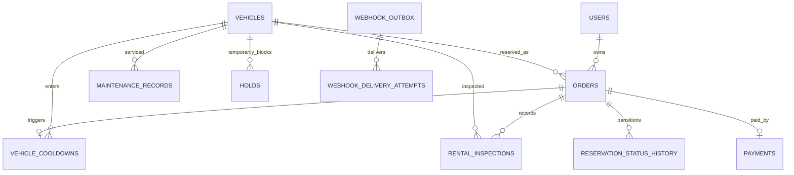

# Modelo entidad-relación V2

`vehicles` conserva su semántica de unidad física. El estado operativo no sustituye el cálculo de disponibilidad en un intervalo: una unidad `DISPONIBLE` puede estar reservada en el futuro y continuar utilizable fuera de ese intervalo.
